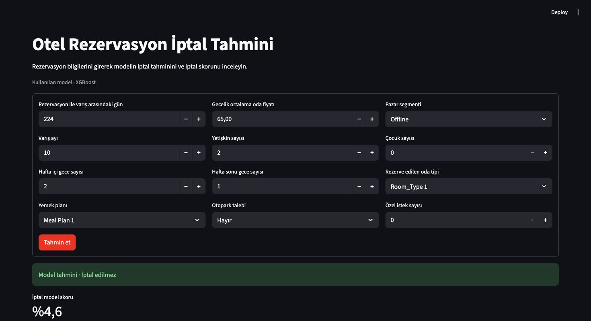

# Otel Rezervasyon İptal Tahmini

Otel rezervasyonlarının iptal edilip edilmeyeceğini tahmin eden, yeniden eğitilebilir bir sınıflandırma projesi. Streamlit formu, eğitimde kullanılan 12 ham alanı alır ve aynı ön işleme hattından geçirir. Sonuç ekranı tahmin edilen sınıfı ve iptal model skorunu gösterir.



Ekran görüntüsü tek bir örneği gösterir. Model skoru kalibre edilmemiştir. 2017–2018 verisine dayanan bu demo, gerçek rezervasyon kararları için doğrulanmış bir sistem değildir.

## Veri ve yöntem

- [Hotel Reservations Dataset](https://www.kaggle.com/datasets/ahsan81/hotel-reservations-classification-dataset) ile eşleşen CSV bu depoda bulunur. 36.275 rezervasyon, 19 sütun ve 11.885 iptal kaydı içerir.
- Ham CSV değişmeden kullanıldı. `Booking_ID`, yıl ve ayın günü model girdilerinden çıkarıldı. Yıl yalnızca iki dönemi temsil ediyor ve gün alanında 37 geçersiz takvim kaydı var. Misafir geçmişi alanları da rezervasyon anındaki bilgi durumları bağımsız olarak doğrulanamadığı için dışarıda bırakıldı.
- Aynı 12 girdi değerine sahip rezervasyonlar bir grup kabul edildi. Gruplu ve sınıf oranlarını gözeten bölme, 29.164 eğitim ve 7.111 test kaydı üretti. Eğitim ile test arasında ortak girdi grubu yok.
- Kategorik kodlayıcı ve lojistik regresyonun ölçekleyicisi her çapraz doğrulama bölümünde yalnızca o bölümün eğitim kısmına uyduruldu. Ağaç modelleri, sayısal sıfırları açık değer olarak alır. Hedef `Canceled = 1` ve `Not_Canceled = 0`.
- Dört modelin seçimi, eğitim verisi içindeki dört gruplu çapraz doğrulama bölümünün ortalama **iptal F1** puanına göre yapıldı. Model seçimi dondurulduktan sonra ayrı test kümesinde dört model de raporlandı. Kodlanan girişler ve seçilen model tek bir scikit-learn hattında saklanır.

## Doğrulama sonuçları

| Model | Eğitim içi iptal F1 | Test doğruluğu | Test iptal F1 | Test ROC AUC |
| --- | ---: | ---: | ---: | ---: |
| Logistic Regression | 0,6764 | %79,99 | 0,6608 | 0,8456 |
| Decision Tree | 0,6936 | %79,26 | 0,6716 | 0,7642 |
| Random Forest | 0,7395 | %84,32 | 0,7273 | 0,8966 |
| **XGBoost** | **0,7679** | **%85,68** | **0,7552** | **0,9212** |

Test kümesinde 2.246 iptal var. Her kayda «iptal edilmez» diyen çoğunluk karşılaştırmasının doğruluğu %68,42. Seçilen XGBoost modelinin iptal kesinliği %82,11, iptal yakalama oranı %69,90. Sayısal sonuçların tamamı, veri özeti ve kullanılan sürümler `docs/evaluation.json` içinde.

Tablo macOS arm64 üzerinde kaydedilen çalıştırmaya ait. Linux’ta Decision Tree ve Random Forest puanlarında küçük farklar görülebilir. GitHub Actions, her adayın doğruluk ve iptal F1 hesaplarını test çıktısıyla karşılaştırır ve seçilen XGBoost için yayımlanan doğruluk, iptal F1 ve karışıklık matrisini yeniden doğrular.

### Orijinal not defterinin sonuçları

| Model | Not defterindeki doğruluk |
| --- | ---: |
| Random Forest | %89,13 |
| XGBoost | %87,79 |

Bu değerler, ardışık IQR temizliğinden kalan 17.158 kaydın 3.432 satırlık rastgele test bölümünden geliyor. Eski testin 1.210 satırı eğitimdeki bir girdiyle birebir eşleşiyordu. Ayrıca eski F1 puanında pozitif sınıf «iptal edilmedi» idi. İki değerlendirmenin örneklemleri ve bölme kuralları farklı. Eski yöntem ve hataların yeniden üretimi `audit_legacy.py` ve teknik denetim raporunda belgeleniyor.

## Kurulum ve çalıştırma

Python **3.12** kullanın. macOS’ta XGBoost için OpenMP çalışma zamanı gerekiyorsa Homebrew ile `brew install libomp` komutunu çalıştırın.

```bash
python3.12 -m venv .venv
source .venv/bin/activate
python -m pip install -r requirements.txt
python train.py
python -m streamlit run app.py
```

`train.py`, `artifacts/reservation_model.joblib` ve `artifacts/evaluation.json` üretir. Uygulama yalnızca bu yerel eğitim çıktısını kullanır. Joblib dosyalarını güvendiğiniz bir eğitim çalışmasından üretin.

## Testler ve GitHub Actions

Hızlı testler için önceden oluşturulmuş bir model gerekmez. Testler grup ayrımını, README’deki sonuçların kayıtlı değerlendirmeyle uyumunu, 12 form alanını, iki tahmin mesajını ve eksik ya da bozuk model dosyasının davranışını kontrol eder.

```bash
python audit_legacy.py
python -m unittest discover -s tests -p test_reservation.py -v
```

Tam doğrulama, dört modeli yeniden eğitir. Yayımlanan sonuçları, seçilen modelin ayrı test kümesindeki sonuçlarını ve gerçek modelin Streamlit mesajlarını kontrol eder.

```bash
python train.py
python -m unittest discover -s tests -p test_trained_model.py -v
```

GitHub Actions her iki kontrolü Python 3.12 ile çalıştırır. **Fast checks** pull request güncellemelerinde çalışır. **Model validation** eğitim kodu, veri seti, bağımlılıklar veya kayıtlı değerlendirme gibi ilgili dosyalar değiştiğinde çalışır. README değişikliği tek başına yeniden eğitim başlatmaz.

## Dosyalar

| Dosya | İçerik |
| --- | --- |
| `app.py` | Streamlit formu ve tahmin gösterimi |
| `reservation.py` | Ortak özellikler, hedef kodlaması ve iptal skorunun okunması |
| `train.py` | Eğitim, model seçimi, ayrı test değerlendirmesi ve model kaydı |
| `audit_legacy.py` | Eski veri seçiminin ve test örtüşmesinin yeniden üretimi |
| `tests/test_reservation.py` | Tam eğitim gerektirmeyen veri, README ve arayüz kontrolleri |
| `tests/test_trained_model.py` | Yeniden üretilen model, test metrikleri ve arayüz doğrulaması |
| `docs/evaluation.json` | Temiz ortamda kaydedilen değerlendirme sonuçları |
| `Hotel Reservations.csv`, `Hotel_Reservation_Projesi.ipynb`, `model.pkl` | Değiştirilmemiş veri ve tarihsel çalışma |

## Demo seçenekleri

Yukarıdaki komutlar yerel demoyu çalıştırır. Bir barındırma hizmetinde önce `train.py` çalıştıran bir kurulum adımı veya aynı sürümlerle üretilen model çıktısı gerekir. Streamlit Community Cloud bu çıktı sağlandığında değerlendirilebilir. Bir konteynerin derleme adımında eğitim çalıştırmak, model dosyasını uygulama çalışmadan önce hazırlamayı sağlar. Yayın öncesi veri lisansı ve barındırma ortamındaki testler ayrıca kontrol edilmelidir.
